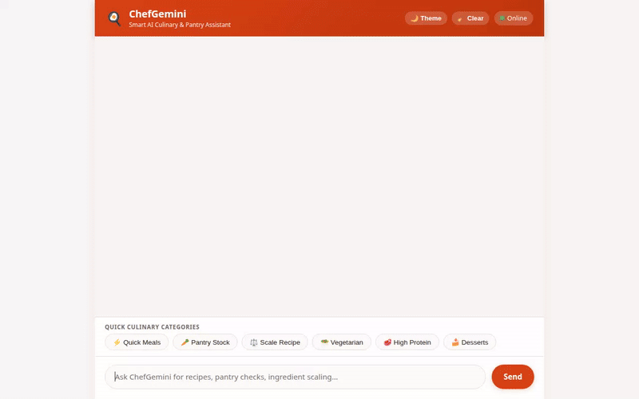

# 🍳 ChefGemini - Smart AI Culinary & Pantry Assistant



ChefGemini is an intelligent AI culinary assistant built with Google Cloud Agent Development Kit (ADK) and deployed to Google Cloud Agent Platform. It manages your pantry inventory, finds and scales recipes, searches local markets, remembers your long-term dietary preferences, and generates AI video clips of recipes.

---

## 🌟 Implemented Features & Google Cloud Services

ChefGemini's capabilities are strictly backed by live backend tools and Google Cloud infrastructure:

### 1. 📦 Pantry Stock & Recipe Database (Google Cloud Firestore)
- **Pantry Tracking**: Query current pantry ingredients (`get_pantry_inventory`) and update stock quantities (`update_pantry_item`).
- **Recipe Management**: Search recipes by category (`get_recipes`), view detailed recipe documents (`get_recipe_by_id`), and store new recipes (`add_recipe`) in Firestore.

### 2. 🧠 Cross-Session Long-Term Memory (Vertex AI Memory Bank)
- **Personalized Context**: Automatically remembers user dietary restrictions, allergies, and ingredient preferences across sessions.
- **Agent Integration**: Leverages `PreloadMemoryTool` and automated memory-generation callbacks wired directly into the ADK runtime.

### 3. 🎥 AI Video Generation (Google Omni Model - `gemini-omni-flash-preview`)
- **Omni Video Synthesis**: Generates short culinary video clips using Google's Omni model (`gemini-omni-flash-preview`) in the `global` Vertex AI region.
- **Cloud Storage & Artifacts**: Saves video parts to ADK Playground Artifacts and uploads public video files directly to Google Cloud Storage (`chefgemini-public-qwiklabs-gcp-01-0d643ff47544`).

### 4. 🎨 Rich Visual UI Cards (Agent-to-User Interface / A2UI)
- **Dynamic Render Cards**: Formats agent responses into structured display UI cards (rows, columns, images, and dividers) rendered directly in the custom web chat application.

### 5. 📍 Location & Grocery Store Search (Google Maps Geocoding & Places API)
- **Store Finding**: Converts street addresses to geographic coordinates (`geocode_address`) and searches for nearby specialty food markets and grocery stores (`search_nearby_places`).

### 6. 🧮 Python Code Sandbox Execution
- **Ingredient Scaling**: Runs Python code inside `AgentEngineSandboxCodeExecutor` to scale recipe proportions, calculate nutrition, and compute cooking time math.

---

## 📋 Planned / Future Capabilities
- **Audio Voice Narration**: Text-to-speech spoken step-by-step cooking instructions (*Planned, not yet implemented*).

---

## 🚀 How to Run Locally

### Prerequisites
- Python 3.11+
- Node.js 18+ (for frontend proxy or demo recording)
- Google Cloud SDK (`gcloud`) authenticated with access to Vertex AI, Firestore, and Cloud Storage.

### Setup & Local Execution

1. **Clone the repository and install dependencies**:
   ```bash
   git clone <your-repo-url>
   cd <your-repo-folder>
   python -m venv .venv
   source .venv/bin/activate
   pip install -r simple-agent/requirements.txt
   ```

2. **Authenticate with Google Cloud**:
   ```bash
   gcloud auth login
   gcloud auth application-default login
   ```

3. **Start the FastAPI Proxy & Frontend Web UI**:
   ```bash
   AGENT_DIRECTORY="app" PORT=8080 python main.py
   ```

4. **Access the Chat UI**:
   Open `http://localhost:8080` in your web browser.

---

## 🏗️ Project Architecture

```
.
├── app/
│   ├── agent.py            # Main ADK Root Agent setup & tool registration
│   ├── firestore_tools.py  # Firestore pantry and recipe database tools
│   ├── video_tools.py      # Vertex AI Omni model video generation & GCS upload
│   ├── location_tools.py   # Geocoding & Places search tools
│   └── external_tools.py   # Recipe search & utility function tools
├── frontend/               # Custom web frontend UI & A2UI renderer
├── main.py                 # FastAPI proxy connecting browser frontend to agent
├── agents-cli-manifest.yaml# Agents CLI deployment configuration
└── README.md
```
